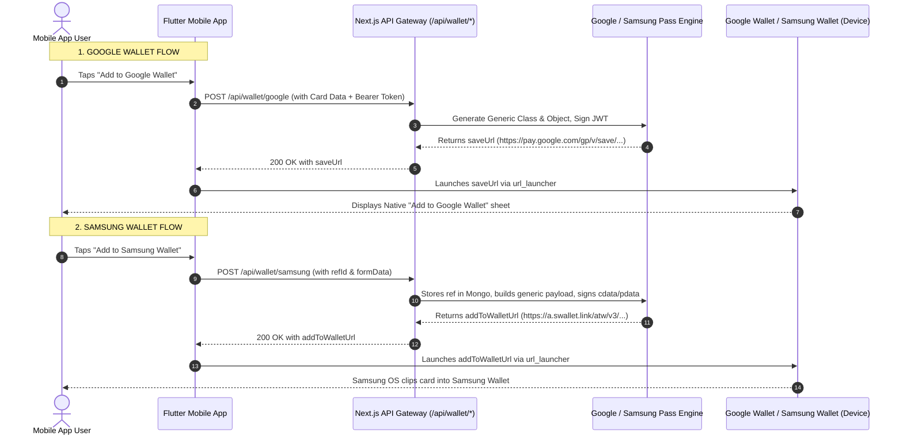

# MyCardShare / DBC Platform — Google & Samsung Wallet End-to-End Integration Guide

> **Target File Location**: `public/Md files/Wallet_Integration_Guide.md`  
> **Purpose**: Complete end-to-end technical blueprint for syncing **Google Wallet** and **Samsung Wallet** passes between the **Flutter Mobile App** and the **Next.js Backend**.

---

## 1. System Architecture Overview

Both **Google Wallet** and **Samsung Wallet** passes in MyCardShare are generated dynamically on the server:



---

## 2. Google Wallet Integration (End-to-End)

### A. Endpoint Details
* **URL**: `POST /api/wallet/google`
* **Headers**:
  * `Authorization`: `Bearer <Firebase_ID_Token>`
  * `Content-Type`: `application/json`

### B. Request Body Payload
```json
{
  "userId": "FIREBASE_USER_UID",
  "fullName": "Saad Khan",
  "jobTitle": "Lead Architect",
  "companyName": "Apex Realty Group",
  "workEmail": "saad.khan@apexrealty.com",
  "workPhone": "+15550199",
  "website": "https://apexrealty.com",
  "themeColor": "#0A84FF",
  "avatarUrl": "https://storage.googleapis.com/.../avatar.jpg",
  "bannerUrl": "https://storage.googleapis.com/.../banner.jpg",
  "publicCardUrl": "https://mycardshare.com/card/saad-khan"
}
```

### C. Backend Processing Pipeline
1. **Banner Pre-Processing**: Crops and darkens banner image (`1032x336`) so overlay text remains legible.
2. **Class & Object Verification**:
   - Class ID: `${ISSUER_ID}.business_card_class_v2`
   - Object ID: `${ISSUER_ID}.${userId}`
3. **Structured Modules Included**:
   - Primary Header: `fullName`
   - Subheader: `jobTitle`
   - Card Title: `companyName`
   - Text Modules: Email, Phone, Website, Location
   - Clickable Action URIs: `mailto:`, `tel:`, Website link, Public card link
   - Barcode: Dynamic QR code pointing to `publicCardUrl`
4. **JWT Signing**: Signs payload with service account credentials (`google-wallet-key.json`).
5. **Fallback to Legacy Proxy**: If local credentials are absent, automatically proxies to `WALLET_LEGACY_BACKEND_URL/api/create-wallet-pass`.

### D. Success Response (200 OK)
```json
{
  "success": true,
  "data": {
    "saveUrl": "https://pay.google.com/gp/v/save/eyJhbGciOiJSUzI1NiIsImtpZCI6...",
    "via": "local"
  }
}
```

### E. Error Responses
* **400 Bad Request**: `{ "success": false, "error": "Full name is required for wallet passes." }`
* **403 Forbidden**: `{ "success": false, "error": "Google Wallet API permission denied / not enabled." }`
* **502 / 503**: Upstream unavailable or credentials missing.

---

## 3. Samsung Wallet Integration (End-to-End)

### A. Endpoint Details
* **URL**: `POST /api/wallet/samsung`
* **Headers**:
  * `Authorization`: `Bearer <Firebase_ID_Token>`
  * `Content-Type`: `application/json`

### B. Request Body Payload
```json
{
  "refId": "ref-USER_UID-1718000000",
  "formData": {
    "uid": "FIREBASE_USER_UID",
    "cardSlug": "saad-khan",
    "fullName": "Saad Khan",
    "jobTitle": "Lead Architect",
    "companyName": "Apex Realty Group",
    "workEmail": "saad.khan@apexrealty.com",
    "workPhone": "+15550199",
    "website": "https://apexrealty.com",
    "address": "100 Financial Plaza",
    "city": "New York",
    "country": "USA",
    "tagline": "Specializing in commercial projects",
    "avatarUrl": "https://storage.googleapis.com/.../avatar.jpg",
    "bannerUrl": "https://storage.googleapis.com/.../banner.jpg",
    "companyLogo": "https://storage.googleapis.com/.../logo.png",
    "themeColor": "#1428A0",
    "publicCardUrl": "https://mycardshare.com/card/saad-khan"
  }
}
```

### C. Backend Processing Pipeline
1. **Ref Persistence**: Stores the card data in MongoDB `samsung_wallet_refs` collection mapped by `refId`.
2. **Attributes Assembly**:
   - `title`: `fullName`
   - `subtitle`: `jobTitle`
   - `providerName`: `companyName`
   - `text1`: Email (Label: "Email")
   - `text2`: Phone (Label: "Phone")
   - `text3`: Website (Label: "Website")
   - `text4`: Address / City / Country (Label: "Location")
   - `text5`: Company Name
   - `text6`: Tagline / Bio
   - `barcode`: Type "QR" pointing to `publicCardUrl`
3. **Pass Link Generation**:
   - **Signed Mode (cdata)**: If `SAMSUNG_PARTNER_ID` and `SAMSUNG_PRIVATE_KEY` exist, signs RS256 JWT and produces:  
     `https://a.swallet.link/atw/v3/${cardId}#Clip?cdata=${token}`
   - **Public Template Fallback (pdata)**: If signing keys are not yet configured, encodes URL JSON payload:  
     `https://a.swallet.link/atw/v3/zAtI/3ir7iadicu000#Clip?pdata=${encodedJson}`

### D. Success Response (200 OK)
```json
{
  "success": true,
  "data": {
    "refId": "ref-USER_UID-1718000000",
    "stored": true,
    "publicCardUrl": "https://mycardshare.com/card/saad-khan",
    "addToWalletUrl": "https://a.swallet.link/atw/v3/3ir7iadicu000#Clip?cdata=eyJhbG..."
  }
}
```

---

## 4. Flutter Mobile App Implementation (Dart Code)

Here is the complete, drop-in `WalletService` class for Flutter.

### `lib/services/wallet_service.dart`

```dart
import 'dart:convert';
import 'package:http/http.dart' as http;
import 'package:firebase_auth/firebase_auth.dart';
import 'package:url_launcher/url_launcher.dart';

class WalletService {
  static const String baseUrl = "https://mycardshare.com"; // Your Backend URL

  /// Helper to get current Firebase JWT Bearer Token
  static Future<Map<String, String>> _getHeaders() async {
    final user = FirebaseAuth.instance.currentUser;
    if (user == null) {
      throw Exception("User is not logged in.");
    }
    final token = await user.getIdToken();
    return {
      "Content-Type": "application/json",
      "Authorization": "Bearer $token",
    };
  }

  // ==========================================
  // 1. ADD TO GOOGLE WALLET
  // ==========================================
  static Future<void> addToGoogleWallet({
    required Map<String, dynamic> cardData,
  }) async {
    final headers = await _getHeaders();
    final user = FirebaseAuth.instance.currentUser!;

    final body = jsonEncode({
      "userId": user.uid,
      "fullName": cardData["fullName"] ?? "",
      "jobTitle": cardData["jobTitle"] ?? "",
      "companyName": cardData["companyName"] ?? "",
      "workEmail": cardData["workEmail"] ?? cardData["email"] ?? "",
      "workPhone": cardData["workPhone"] ?? cardData["phone"] ?? "",
      "website": cardData["website"] ?? "",
      "themeColor": cardData["themeColor"] ?? "#0A84FF",
      "avatarUrl": cardData["avatarUrl"],
      "bannerUrl": cardData["bannerUrl"],
      "publicCardUrl": cardData["publicCardUrl"] ??
          "https://mycardshare.com/card/${cardData["cardSlug"] ?? user.uid}",
    });

    final response = await http.post(
      Uri.parse("$baseUrl/api/wallet/google"),
      headers: headers,
      body: body,
    );

    if (response.statusCode == 200) {
      final json = jsonDecode(response.body);
      final saveUrl = json["data"]?["saveUrl"];

      if (saveUrl != null && saveUrl.toString().isNotEmpty) {
        final uri = Uri.parse(saveUrl);
        // Launch external app: triggers Google Wallet pass install sheet
        if (await canLaunchUrl(uri)) {
          await launchUrl(uri, mode: LaunchMode.externalApplication);
        } else {
          throw Exception("Could not open Google Wallet URL.");
        }
      } else {
        throw Exception("Invalid saveUrl received from server.");
      }
    } else {
      final errorJson = jsonDecode(response.body);
      throw Exception(
        errorJson["error"] ?? "Google Wallet pass creation failed.",
      );
    }
  }

  // ==========================================
  // 2. ADD TO SAMSUNG WALLET
  // ==========================================
  static Future<void> addToSamsungWallet({
    required Map<String, dynamic> cardData,
  }) async {
    final headers = await _getHeaders();
    final user = FirebaseAuth.instance.currentUser!;
    final refId = "ref-${user.uid}-${DateTime.now().millisecondsSinceEpoch}";

    final body = jsonEncode({
      "refId": refId,
      "formData": {
        "uid": user.uid,
        "cardSlug": cardData["cardSlug"] ?? user.uid,
        "fullName": cardData["fullName"] ?? "",
        "jobTitle": cardData["jobTitle"] ?? "",
        "companyName": cardData["companyName"] ?? "",
        "workEmail": cardData["workEmail"] ?? cardData["email"] ?? "",
        "workPhone": cardData["workPhone"] ?? cardData["phone"] ?? "",
        "website": cardData["website"] ?? "",
        "address": cardData["address"] ?? "",
        "city": cardData["city"] ?? "",
        "country": cardData["country"] ?? "",
        "tagline": cardData["bio"] ?? cardData["tagline"] ?? "",
        "avatarUrl": cardData["avatarUrl"],
        "bannerUrl": cardData["bannerUrl"],
        "companyLogo": cardData["companyLogo"],
        "themeColor": cardData["themeColor"] ?? "#1428A0",
        "publicCardUrl": cardData["publicCardUrl"] ??
            "https://mycardshare.com/card/${cardData["cardSlug"] ?? user.uid}",
      },
    });

    final response = await http.post(
      Uri.parse("$baseUrl/api/wallet/samsung"),
      headers: headers,
      body: body,
    );

    if (response.statusCode == 200) {
      final json = jsonDecode(response.body);
      final addToWalletUrl = json["data"]?["addToWalletUrl"];

      if (addToWalletUrl != null && addToWalletUrl.toString().isNotEmpty) {
        final uri = Uri.parse(addToWalletUrl);
        // Launch external app: Samsung devices intercept a.swallet.link
        if (await canLaunchUrl(uri)) {
          await launchUrl(uri, mode: LaunchMode.externalApplication);
        } else {
          throw Exception("Could not open Samsung Wallet URL.");
        }
      } else {
        throw Exception("Invalid addToWalletUrl received from server.");
      }
    } else {
      final errorJson = jsonDecode(response.body);
      throw Exception(
        errorJson["error"] ?? "Samsung Wallet pass creation failed.",
      );
    }
  }
}
```

---

## 5. Mobile UI Integration Example (Flutter Widget)

```dart
Row(
  children: [
    // Google Wallet Button
    Expanded(
      child: ElevatedButton.icon(
        icon: Image.asset("assets/icons/google_wallet.png", height: 24),
        label: const Text("Google Wallet"),
        style: ElevatedButton.styleFrom(
          backgroundColor: Colors.white,
          foregroundColor: Colors.black,
        ),
        onPressed: () async {
          try {
            await WalletService.addToGoogleWallet(cardData: currentCard);
          } catch (e) {
            ScaffoldMessenger.of(context).showSnackBar(
              SnackBar(content: Text("Error: $e")),
            );
          }
        },
      ),
    ),
    const SizedBox(width: 12),
    // Samsung Wallet Button
    Expanded(
      child: ElevatedButton.icon(
        icon: Image.asset("assets/icons/samsung_wallet.png", height: 24),
        label: const Text("Samsung Wallet"),
        style: ElevatedButton.styleFrom(
          backgroundColor: const Color(0xFF1428A0),
          foregroundColor: Colors.white,
        ),
        onPressed: () async {
          try {
            await WalletService.addToSamsungWallet(cardData: currentCard);
          } catch (e) {
            ScaffoldMessenger.of(context).showSnackBar(
              SnackBar(content: Text("Error: $e")),
            );
          }
        },
      ),
    ),
  ],
)
```

---

## 6. Required Environment Variables Reference

Ensure the following variables exist in `.env` on your backend server:

```ini
# Google Wallet
ISSUER_ID=3388000000023060239
GOOGLE_APPLICATION_CREDENTIALS=./google-wallet-key.json

# Samsung Wallet
SAMSUNG_PARTNER_ID=4138380922850138240
SAMSUNG_CARD_ID=3ir7iadicu000
SAMSUNG_CERTIFICATE_ID=zAtI
SAMSUNG_PRIVATE_KEY_PATH=./samsung-private-key.pem

# Public Base URL (Required so Wallet can fetch images & render QR)
NEXT_PUBLIC_BASE_URL=https://mycardshare.com
```

---

> **Summary**: Both wallets work out of the box with zero native SDK complexity required on Flutter. The backend generates signed one-click URLs (`saveUrl` / `addToWalletUrl`), and Flutter opens them via `url_launcher` with `LaunchMode.externalApplication`.
